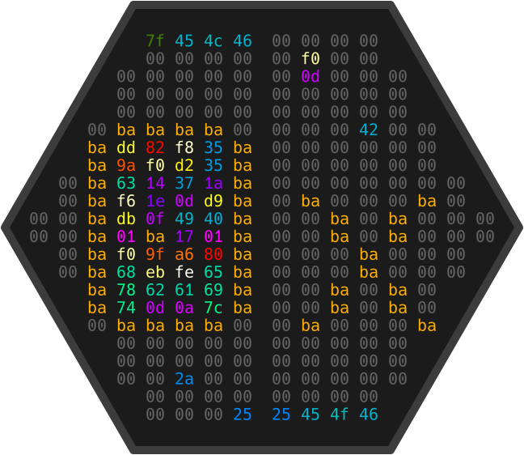

# hexbait - Hierarchical EXploration Binary Analysis & Inspection Tool

Hexbait is a hex viewer for exploring files you don't understand yet, from multi-gigabyte disk images down to individual bytes.
Instead of a fixed grid of hex bytes, the view adapts to the scale you are looking at: statistical overviews of large regions when zoomed out, byte-colored maps in between, and a hex dump once you are close enough to read it.



## Demo

https://github.com/user-attachments/assets/40a44ccb-06e6-430d-b4f1-71d6c5665754

## Status

Hexbait is in an early release state (0.0.x).
It is usable enough that I use it regularly, but expect some rough edges:

- **The viewer** itself is usable. The command-line options and the UI may still change between releases.
- **The format description language** (`.hbl`) is unstable and sparsely documented (see `hexbait-lang/grammar.ungram`) but usable.
  Breaking changes are planned, so format descriptions you write now will likely need updating.
- Some features are incomplete and hexbait may (safely) crash in places that aren't implemented yet.

## Installation

Download the archive for your platform from the [releases page](https://github.com/aticu/hexbait/releases) and extract it.
In it there are two programs:

- `hexbait`: the GUI-based hex viewer
- `hexbait-parse`: the command-line tool that parses a file according to a format description and outputs the results as JSON

### macOS

I have never tried running hexbait on macOS, so I cannot guarantee anything.
Feel free to give it a try.
If macOS refuses to run the binaries try removing the quarantine flag:

```sh
xattr -d com.apple.quarantine hexbait hexbait-parse
```

### Building from source

Install Rust (hexbait usually requires the latest stable version) and run:

```sh
cargo install --git https://github.com/aticu/hexbait hexbait hexbait-parse
```

## Usage

Hexbait currently has no file dialog, so start it from a terminal with a file to open:

```sh
hexbait path/to/file
```

Without an argument, stdin is read instead:

```sh
some_command | hexbait
```

On Windows you can drag a file onto `hexbait.exe` to open it.
Files are read on demand but piped input is loaded into memory fully.

One or more additional format descriptions can be loaded with `-p path/to/description.hbl`.

For more detailed usage information check out [the tutorial](docs/TUTORIAL.md) or [the reference](docs/REFERENCE.md).

## Safety

If you want to open arbitrary files and possibly even parse them, safety is an important aspect.
That is why hexbait uses `#![forbid(unsafe_code)]` everywhere.
This means that bugs in hexbait can crash hexbait but not cause any memory corruption.
You should however beware that this does not mean that dependencies of hexbait are guaranteed to be bug-free.
Still, since most of the untrusted data is handled by hexbait itself, vulnerabilities are quite unlikely.

## Goals

- Easy and fun to use. The best tool for most jobs involving hex viewing.
- Easy to explore unknown data formats at the byte-level.
- Easy to get an overview of even very large files.

## Non-goals

- Hexbait is not and will never be a hex editor.
- Hexbait is not a hex diffing-tool. This may change in the future, but does not fit the current vision.

## License

MIT, see [LICENSE](LICENSE).
