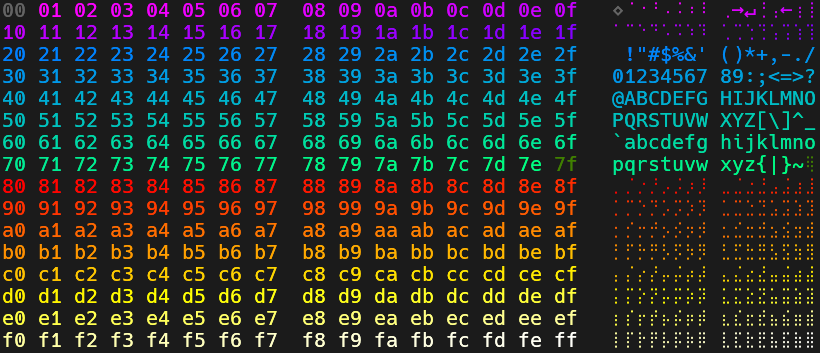
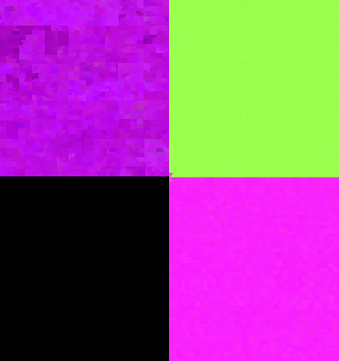

# Hexbait reference

This is a [reference](https://diataxis.fr/reference/) for using hexbait.

## Controls

The main content area is split into two parts:

- To the left are the zoombars.
  They represent nested zoomed in views of the selection of their left-most neighbor.
  The color scheme of the zoombars is described in the section on [statistical colors](#statistical-colors).
- To the right of that is the content view.
  The content view changes based on the zoom-level.

| Zoom level                | Meaning                                                  |
|---------------------------|----------------------------------------------------------|
| Zoomed in (or small file) | Hex view                                                 | 
| Medium (or medium file)   | Overview map ([byte colors](#byte-colors))               |
| Zoomed out                | Overview map ([statistical colors](#statistical-colors)) |

In the hex view there is an additional bar that represents a minimap of the bytes in the area around the current view.

The following actions can be used to control hexbait in the main content area.

| Location     | Action       | Effect                                                           |
|--------------|--------------|------------------------------------------------------------------|
| Zoombars     | Left-click   | Zoom into hex view at the specified position                     |
| Zoombars     | Left-drag    | Select a region and open it as a bar to the right                |
| Zoombars     | Right-drag   | Move the selection                                               |
| Zoombars     | Mouse wheel  | Scroll                                                           |
| Zoombars     | Double-click | Reset the bar's selection                                        |
| Zoombars     | Click a mark | Jump to the marked location                                      |
| Overview map | Mouse wheel  | Change size of selected region (shift for finer steps)           |
| Overview map | Click        | Zoom into the highlighted area                                   |
| Hex view     | Click        | Selects the clicked byte (or deselects it if it's a single byte) |
| Hex view     | Shift-click  | Selects bytes between selection start and clicked byte           |
| Hex view     | Drag         | Select multiple bytes                                            |
| Hex view     | Ctrl-C       | Copies the selected bytes if they are text                       |
| Hex view     | Right-click  | Opens a context menu with various actions                        |
| Hex view     | Ctrl-click   | Mark or unmark a byte                                            |
| Hex view     | Mouse wheel  | Scroll                                                           |

## Byte colors

The byte colors in hexbait are separated into different groups.
Within each group there's a gradient for each byte value.
This way each byte color is different but similar colors have a similar value.
The groups are:

| name                     | byte values | colors                      |
|--------------------------|-------------|-----------------------------|
| zeroes                   | `00`        | gray                        |
| ASCII control characters | `01`-`1f`   | magenta to violet           |
| printable ASCII          | `20`-`7e`   | blue to green               |
| delete char              | `7f`        | dark green                  |
| high bytes               | `80`-`ff`   | red through yellow to white |

## Statistical colors

The statistical colors are computed for a larger area of a file and represent the statistical distribution of the bytes in that area.
They consist of three components that are each computed on high-nibble bigrams of the data (for example the byte sequence `7f 80` would count as one entry of `7x` followed by `8x`).
Each of the components is mapped to one of the three RGB-color channels.

The three components are:

| component                                      | channel |
|------------------------------------------------|---------|
| conditional entropy                            | red     |
| printable ASCII concentration                  | green   |
| byte delta (how much consecutive bytes differ) | blue    |

Here are some example data types and how they are displayed:

| data                                          | color                     |
|-----------------------------------------------|---------------------------|
| ASCII text                                    | bright green              |
| UTF-16 encoded ASCII text                     | violet-blue               |
| machine code                                  | purple to magenta, patchy |
| high-entropy data (e.g. encrypted/compressed) | bright pink-magenta, even |
| zeroes                                        | black                     |

Machine code and compressed or encrypted data have similar colors, because both use most byte values.
Compressed and encrypted data is nearly unpredictable, so its conditional entropy (red) is at its maximum: it is bright and looks the same everywhere.
Machine code has patterns that make the next byte somewhat predictable, so it has less red and looks darker. These patterns differ from one part of the code to the next, which makes it look patchy.

In this image you can see machine code (AMD64) in the top left, text in the top right, zeroes in the bottom left and random bytes, which look the same as encrypted data, in the bottom right.

## Format descriptions

Hexbait can parse data according to format descriptions written in its own language.
The language is called "hexbait language" or short "hbl".
Descriptions for some formats are built-in, but user supplied format descriptions are also supported.
To use them use the `-p path/to/description.hbl` flag for `hexbait` and the `-c path/to/description.hbl` for `hexbait-parse`.

The language itself is currently unstable and subject to change.
An up to date grammar can be found in `hexbait-lang/grammar.ungram` along with some comments describing the semantics of the constructs.
Additionally the format descriptions in the `format_descriptions` folder can be used as examples when writing new format descriptions.
