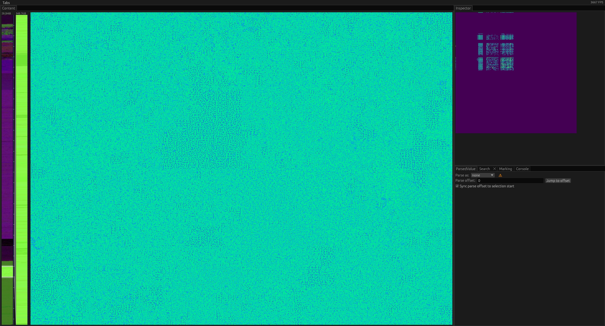
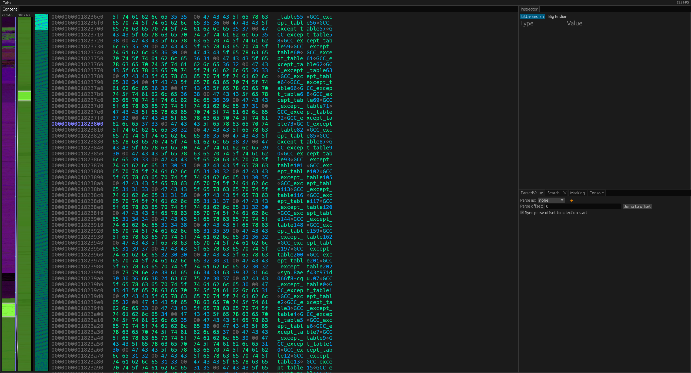
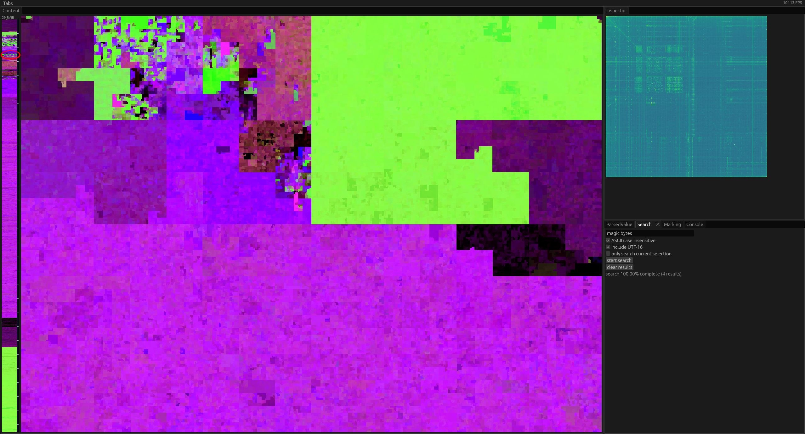
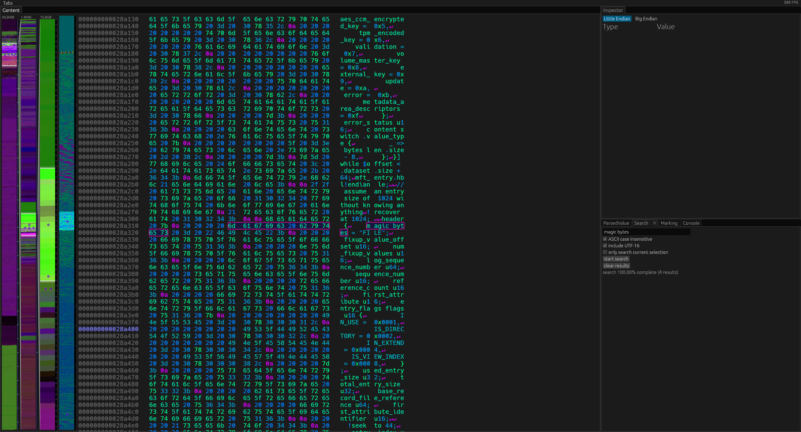
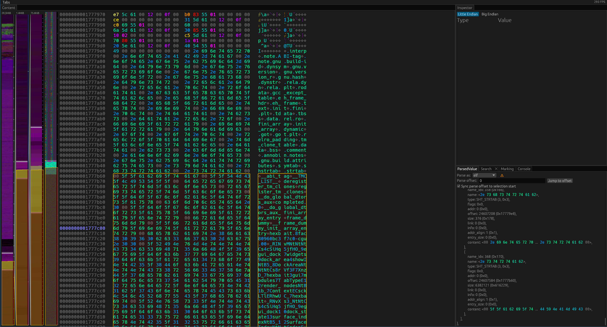

# Hexbait tutorial

This is a [tutorial](https://diataxis.fr/tutorials/) for using hexbait.
In this tutorial we explore a file without knowing its format: we look at the whole file at once, zoom down to individual bytes, search for text, mark a location and finally parse the file.
It takes about 15 minutes.

## Before you start

You need:
- hexbait, installed as described in the [README](../README.md)
- the example file: download it [here](https://github.com/aticu/hexbait/releases/download/example-file/example-file) (about 30MiB)

The example file is hexbait itself, built for Linux.
You won't run it, only look at it, so it works the same on every operating system.

Your window will probably have a different size than the one in the screenshots.
The shapes on the overview map then look different, but the colors are the same.
If you have a screen with a very high resolution your window may look different than in the screenshot below.
In this case you can make the hexbait window smaller to follow along with the tutorial.
Larger screens can fit more pixels, so hexbait can show more detailed information on them without zooming in as much.

## 1. Open the file

On Linux or macOS open a terminal in the folder containing the example file and run:

```sh
hexbait example-file
```

On Windows you can instead drag `example-file` onto `hexbait.exe`.

The hexbait window opens.
Hexbait starts analyzing the file right away.
For a 30MiB file this takes only a moment, and you can use hexbait in the meantime; the overview just becomes more detailed once it finishes.

## 2. Get an overview


On the left is a narrow vertical bar, the *zoombar*.
It shows the whole file from top (start) to bottom (end).
The large square next to it is the *overview map*.
It shows the same file, folded into a square so that more of it fits on the screen.

Both use colors to show what kind of data is where.
Notice three colors:

- **Purple and magenta** cover most of the file.
  This is data with many different byte values, such as machine code.
- **Bright green** is text.
  There is a large green area on the map and a green band at the bottom of the zoombar.
- **Black** is zeroes.
  There is a black patch on the map and a thin black line about three quarters down the zoombar.

Now move the mouse over the large green area on the map.
Everything else gets darker, on the map and on the zoombar.
On the zoombar only the bottom part stays bright: the green area on the map and the green band on the zoombar are the same data.

## 3. Zoom in on the text

Let's look at that text more closely.

On the zoombar, press the left mouse button inside the green band at the bottom, drag down a short distance (about the width of the zoombar) and release.
A second zoombar appears to the right of the first.
It shows only the part you selected.



The overview map has changed too.
You are now close enough that the map can show every byte separately, so it colors each byte by its value instead of summarizing.
The blue-green you see is the color of printable text characters.
Each byte value has its own color described in the [reference](REFERENCE.md).

Now move the mouse over the map.
A region around the pointer is highlighted.
Scroll the mouse wheel up to make the highlighted region smaller (and down to make it larger).
Make it as small as possible and click.



You have reached the hex view, where you can read the individual bytes.
On the right you can see them as text: run-together fragments containing words like `GCC_except_table`.
These are the names of functions and symbols in hexbait and the libraries it uses.
This part of the file is a table that stores them.

If you see another overview map instead of the hex view, scroll up further and click again.

Scroll with the mouse wheel to move through the bytes.
The narrow bar between the zoombars and the hex view shows the bytes around your position in the same colors as the hex view.

## 4. Zoom back out

Double-click the first zoombar.
The other zoombars disappear and you are back at the overview of the whole file.

## 5. Search for text

Open the *Search* tab in the bottom right panel.
Click into the text field, type `magic bytes` and press Enter.
The search finds 4 results.



The results appear as small blue dots near the top of the zoombar.
Notice that they lie on a thin green line: the overview already showed you that there is text there.
Depending on the background in the bar they may sometimes be a little hard to spot.
They are highlighted in the screenshot to help you spot them.

Move the mouse over one of the dots.
A tooltip shows where the result is.
Click the dot.



Hexbait jumps to the result and frames the found text.
The text around it looks like source code: it is one of hexbait's built-in format descriptions, which tell hexbait how to read a file format.
Hexbait carries their source with it, so you just found hexbait's own instructions inside hexbait.

Notice the purple bytes `0a` with a `↵` next to them.
These are line breaks, which are not printable and therefore have a different color.

## 6. Mark a location

Let's remember this location.

Hold Ctrl and click the `6d` at the start of the framed `magic bytes`.
The byte is now marked.

Double-click the first zoombar to zoom out again.
Near the top of the zoombar, among the blue dots of the search results, there is now a white dot with a red border: your mark.
Click it, and you are back at the marked byte.

The *Marking* tab lists all marks you have made.
There you can also adjust the name that is used for marking to tell marked locations apart.

## 7. Parse the file

So far we have explored the file without knowing its format.
Now let's check what we found against the file's actual structure.

Open the *ParsedValue* tab in the bottom right panel and make sure that the *Parse offset* is set to `0`.
If you cannot change the value it's likely because you have selected some bytes somewhere.
To change the value you can unselect the bytes by selecting a single byte in the hex view and unselecting it again by clicking it again.
Alternatively you can leave your selected bytes as before and uncheck the checkmark labeled *Sync parse offset to selection start*.

Now choose `elf` under *Parse as*.
ELF is the format of programs on Linux.
The panel now shows the parsed file.
At the top you can see that it starts with the bytes `7f 45 4c 46` (`ELF` in text), and that it is a program for 64-bit x86 computers (`EM_X86_64`).

Scroll to the bottom of the panel.
The last entry under sections has the name `<2e 73 74 72 74 61 62>`, which is `.strtab` written as bytes: the table of names you found in step 3.
Click on the name to jump to the location in the file from which it was parsed.
There you can see the name spelled out.
Finally move the mouse over its `content`.



A yellow box appears on the zoombar.
It covers exactly the green band at the bottom: the text you found by looking at the colors is this part of the file.
You can also see where exactly the section begins in the hex view.

If you like, scroll up through the sections and find the one with by far the largest size, `.text` (`2e 74 65 78 74`).
Its `content` covers the large purple middle of the file: hexbait's machine code.

## Summary

In this tutorial you have:

- read an overview of a whole file by its colors
- zoomed in with the zoombars and the overview map, and zoomed back out
- searched for text and jumped to a result
- marked a location and returned to it
- parsed a file and matched its structure to what you saw

Now try hexbait on a file of your own.
The [reference](REFERENCE.md) describes all controls and explains what the colors mean.
